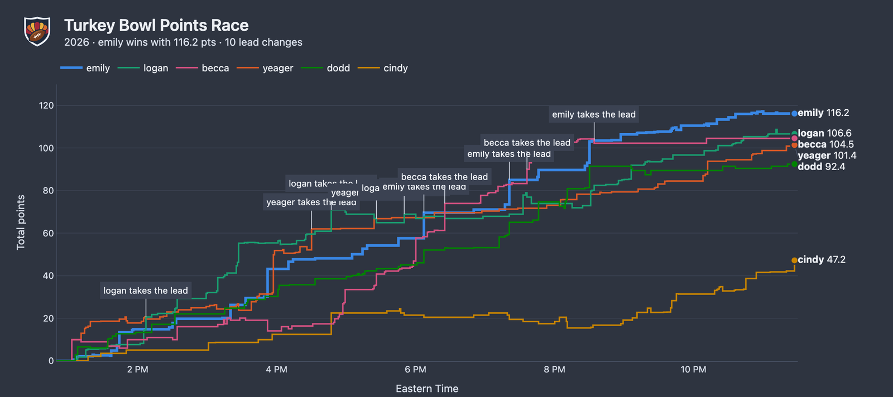

## Leaderboard

| #   | Participant | Points | Projected |
| :-- | :---------- | -----: | --------: |
| 1   | Emily       | 116.16 |      94.3 |
| 2   | Logan       | 106.62 |      89.9 |
| 3   | Becca       | 104.54 |      98.1 |
| 4   | Yeager      | 101.40 |      95.1 |
| 5   | Dodd        |  92.44 |      98.2 |
| 6   | Cindy       |  47.24 |      82.2 |

### Points Race
<iframe class="tb-chart" scrolling="no" data-src="/assets/charts/2026/2026_points_race.html" title="2026 Turkey Bowl Points Race" loading="lazy"></iframe>
<a class="tb-chart-still" href="/assets/charts/2026/2026_points_race.html">
  
  Tap to open the interactive race, then turn your phone sideways to play.
</a>

[Open the points race full screen](/assets/charts/2026/2026_points_race.html)
{: .tb-chart-link}

### Games

| Kickoff     | Matchup   | Network |
| :---------- | :-------- | :------ |
| 1:00 PM ET  | CHI @ DET | CBS     |
| 4:30 PM ET  | PHI @ DAL | Fox     |
| 8:20 PM ET  | KC @ BUF  | NBC     |

### Draft Order

| Pick | Participant |
| :--- | :---------- |
| 1    | Emily       |
| 2    | Yeager      |
| 3    | Logan       |
| 4    | Cindy       |
| 5    | Becca       |
| 6    | Dodd        |

### Rosters

#### Emily

| Slot  | Player          | Team |  Pts | Proj |
| :---- | :-------------- | :--- | ---: | ---: |
| QB    | Patrick Mahomes | KC   |  7.2 | 17.6 |
| RB    | Jahmyr Gibbs    | DET  | 48.2 | 25.6 |
| RB    | Ray Davis       | BUF  |  0.6 |  1.5 |
| WR    | DeVonta Smith   | PHI  | 43.0 | 14.4 |
| WR    | Khalil Shakir   | BUF  |  6.3 |  8.9 |
| TE    | Dallas Goedert  | PHI  |  1.9 |  8.3 |
| FLEX  | Xavier Worthy   | KC   |  0.0 |  6.6 |
| K     | Harrison Butker | KC   |  3.0 |  7.4 |
| DEF   | Buffalo Bills   | BUF  |  6.0 |  4.1 |
| Bench | Elijah Moore    | PHI  |  8.7 |  1.5 |
| **Total** (no bench) | | | **116.2** | **94.3** |

#### Logan

| Slot  | Player              | Team |  Pts | Proj |
| :---- | :------------------ | :--- | ---: | ---: |
| QB    | Jared Goff          | DET  | 15.8 | 16.9 |
| RB    | James Cook III      | BUF  | 19.5 | 14.2 |
| RB    | D'Andre Swift       | CHI  | 29.2 | 14.0 |
| WR    | Rashee Rice         | KC   |  3.9 | 11.1 |
| WR    | Ryan Flournoy       | DAL  |  0.0 |  8.0 |
| TE    | Dalton Kincaid      | BUF  |  3.3 |  8.2 |
| FLEX  | Kyle Monangai       | CHI  | 15.9 |  7.8 |
| K     | Jake Elliott        | PHI  | 12.0 |  6.8 |
| DEF   | Philadelphia Eagles | PHI  |  7.0 |  3.0 |
| Bench | Makai Lemon         | PHI  | 16.1 |  7.3 |
| **Total** (no bench) | | | **106.6** | **89.9** |

#### Becca

| Slot  | Player           | Team |  Pts | Proj |
| :---- | :--------------- | :--- | ---: | ---: |
| QB    | Dak Prescott     | DAL  | 25.5 | 19.5 |
| RB    | Javonte Williams | DAL  | 33.3 | 17.1 |
| RB    | Will Shipley     | PHI  |  4.6 |  4.8 |
| WR    | CeeDee Lamb      | DAL  | 20.4 | 20.4 |
| WR    | Josh Downs       | KC   |  2.3 |  8.3 |
| TE    | Sam LaPorta      | DET  | 14.4 | 10.8 |
| FLEX  | Isaac TeSlaa     | DET  |  0.0 |  4.7 |
| K     | Cairo Santos     | CHI  |  8.0 |  8.9 |
| DEF   | Chicago Bears    | CHI  | -4.0 |  3.7 |
| Bench | KaVontae Turpin  | DAL  | 11.1 |  2.6 |
| **Total** (no bench) | | | **104.5** | **98.1** |

#### Yeager

| Slot  | Player            | Team |  Pts | Proj |
| :---- | :---------------- | :--- | ---: | ---: |
| QB    | Caleb Williams    | CHI  | 25.3 | 16.0 |
| RB    | Emmett Johnson    | KC   | 19.6 | 17.6 |
| RB    | Jashaun Corbin    | DAL  |  2.1 |  4.6 |
| WR    | George Pickens    | DAL  | 11.7 | 15.0 |
| WR    | DJ Moore          | BUF  |  3.5 | 12.4 |
| TE    | Brevyn Spann-Ford | DAL  |  2.5 |  3.6 |
| FLEX  | Rome Odunze       | CHI  | 26.7 | 10.9 |
| K     | Jake Bates        | DET  | 10.0 |  9.6 |
| DEF   | Detroit Lions     | DET  |  0.0 |  5.5 |
| Bench | Keon Coleman      | BUF  |  0.0 |  4.9 |
| **Total** (no bench) | | | **101.4** | **95.1** |

#### Dodd

| Slot  | Player             | Team |  Pts | Proj |
| :---- | :----------------- | :--- | ---: | ---: |
| QB    | Joe Milton         | PHI  | 30.7 | 15.5 |
| RB    | Saquon Barkley     | PHI  |  0.7 | 14.2 |
| RB    | Sione Vaki         | DET  |  3.5 |  4.1 |
| WR    | Amon-Ra St. Brown  | DET  | 21.6 | 17.8 |
| WR    | Jameson Williams   | DET  | 14.0 | 12.3 |
| TE    | Colston Loveland   | CHI  | -0.5 | 10.5 |
| FLEX  | Darius Cooper      | PHI  |  2.4 |  8.3 |
| K     | Brandon Aubrey     | DAL  |  9.0 | 10.4 |
| DEF   | Kansas City Chiefs | KC   | 11.0 |  5.2 |
| Bench | Zavion Thomas      | CHI  |  0.0 |  3.8 |
| **Total** (no bench) | | | **92.4** | **98.2** |

#### Cindy

| Slot  | Player            | Team |  Pts | Proj |
| :---- | :---------------- | :--- | ---: | ---: |
| QB    | Josh Allen        | BUF  |  3.5 | 18.1 |
| RB    | Ty Johnson        | BUF  |  3.2 |  5.1 |
| RB    | Jaydn Ott         | KC   |  0.0 |  4.5 |
| WR    | Luther Burden III | CHI  |  7.5 | 13.0 |
| WR    | Kalif Raymond     | CHI  |  5.0 |  7.2 |
| TE    | Travis Kelce      | KC   | 11.1 | 11.5 |
| FLEX  | Cyrus Allen       | KC   |  2.9 |  5.2 |
| K     | Tyler Bass        | BUF  | 11.0 | 10.3 |
| DEF   | Dallas Cowboys    | DAL  |  3.0 |  7.3 |
| Bench | Tyrell Shavers    | BUF  |  0.0 |  2.3 |
| **Total** (no bench) | | | **47.2** | **82.2** |

**Full event log**: [log file](/assets/logs/2026/2026_turkey-bowl.log)

[Archived Results](/turkey-bowl/archive/)

